# HireNoon — все 37 таблиц

```mermaid
erDiagram
    APP_USER ||--o| SEEKER_PROFILE : profile
    APP_USER ||--o| EMPLOYER_PROFILE : profile
    SEEKER_PROFILE ||--o{ SEEKER_EXPERIENCE : experience
    SEEKER_PROFILE ||--o{ SEEKER_EDUCATION : education
    SEEKER_PROFILE ||--o{ SEEKER_SKILL : skill
    SEEKER_PROFILE ||--o{ SEEKER_PROJECT : project
    EMPLOYER_PROFILE ||--o{ EMPLOYER_TECHNOLOGY : technology
    EMPLOYER_PROFILE ||--o{ EMPLOYER_CULTURE : culture
    EMPLOYER_PROFILE ||--o{ VACANCY : vacancy
    VACANCY ||--o{ VACANCY_HISTORY : version
    VACANCY ||--o{ VACANCY_CATEGORY : tag
    CATEGORY ||--o{ VACANCY_CATEGORY : tag
    VACANCY_HISTORY ||--o{ VACANCY_VERSION_SKILL : skill
    SEEKER_PROFILE ||--o{ RESUME : resume
    RESUME ||--o| RESUME_LEGACY_CONTENT : archive
    RESUME ||--o{ RESUME_EXPERIENCE : experience
    RESUME ||--o{ RESUME_EDUCATION : education
    RESUME ||--o{ RESUME_SKILL : skill
    RESUME ||--o{ RESUME_PROJECT : project
    RESUME ||--o{ RESUME_CATEGORY : tag
    CATEGORY ||--o{ RESUME_CATEGORY : tag
    RESUME ||--o{ PDF_DOCUMENT : pdf
    SEEKER_PROFILE ||--o{ APPLICATION : applies
    VACANCY_HISTORY ||--o{ APPLICATION : applied
    APPLICATION ||--o{ APPLICATION_STATUS_HISTORY : status
    APP_USER o|--o{ APPLICATION_STATUS_HISTORY : changes
    APPLICATION ||--|| APPLICATION_RESUME_SNAPSHOT : snapshot
    RESUME o|--o{ APPLICATION_RESUME_SNAPSHOT : source
    APPLICATION_RESUME_SNAPSHOT ||--o{ APPLICATION_SNAPSHOT_EXPERIENCE : experience
    APPLICATION_RESUME_SNAPSHOT ||--o{ APPLICATION_SNAPSHOT_EDUCATION : education
    APPLICATION_RESUME_SNAPSHOT ||--o{ APPLICATION_SNAPSHOT_SKILL : skill
    APPLICATION_RESUME_SNAPSHOT ||--o{ APPLICATION_SNAPSHOT_PROJECT : project
    APPLICATION_RESUME_SNAPSHOT ||--o{ APPLICATION_SNAPSHOT_CATEGORY : category
    APPLICATION ||--o{ APPLICATION_NOTE : notes
    APP_USER o|--o{ APPLICATION_NOTE : authors
    APP_USER ||--o{ FAVORITE_VACANCY : favorite
    VACANCY ||--o{ FAVORITE_VACANCY : favorite
    APP_USER ||--o{ VACANCY_NOTE : note
    VACANCY ||--o{ VACANCY_NOTE : note
    APP_USER ||--o{ NOTIFICATION : notification
    NOTIFICATION_TOPIC ||--o{ NOTIFICATION : template
    APPLICATION ||--o| CHAT : chat
    CHAT ||--o{ MESSAGE : message
    APP_USER ||--o{ MESSAGE : writes
    APP_USER {
        attr user_id PK
        attr email UK
        attr password_hash
        attr role
        attr created_at
        attr updated_at
    }
    SEEKER_PROFILE {
        attr user_id PK,FK
        attr first_name
        attr last_name
        attr phone
        attr about
        attr avatar_key
        attr created_at
        attr updated_at
        attr city
        attr messenger
        attr contact_email
        attr preferred_position
        attr preferred_cities
        attr work_format
    }
    SEEKER_EXPERIENCE {
        attr experience_id PK
        attr seeker_id FK
        attr company_name
        attr position_title
        attr started_on
        attr ended_on
        attr is_current
        attr achievements
        attr position
        attr created_at
        attr updated_at
    }
    SEEKER_EDUCATION {
        attr education_id PK
        attr seeker_id FK
        attr record_type
        attr institution
        attr completion_year
        attr specialization
        attr position
        attr created_at
        attr updated_at
    }
    SEEKER_SKILL {
        attr skill_id PK
        attr seeker_id FK
        attr name
        attr position
        attr created_at
        attr updated_at
    }
    SEEKER_PROJECT {
        attr project_id PK
        attr seeker_id FK
        attr title
        attr url
        attr description
        attr position
        attr created_at
        attr updated_at
    }
    EMPLOYER_PROFILE {
        attr user_id PK,FK
        attr company_name
        attr description
        attr website
        attr logo_key
        attr created_at
        attr updated_at
        attr industry
        attr team_size
        attr main_city
        attr benefits
        attr hiring_email
        attr office_address
    }
    EMPLOYER_TECHNOLOGY {
        attr technology_id PK
        attr employer_id FK
        attr name
        attr position
        attr created_at
        attr updated_at
    }
    EMPLOYER_CULTURE {
        attr culture_id PK
        attr employer_id FK
        attr title
        attr short_description
        attr description
        attr position
        attr created_at
        attr updated_at
    }
    CATEGORY {
        attr category_id PK
        attr name UK
        attr created_at
        attr updated_at
    }
    VACANCY {
        attr vacancy_id PK
        attr employer_id FK
        attr created_at
        attr updated_at
        attr apply_until
    }
    VACANCY_HISTORY {
        attr vacancy_id PK,FK
        attr version PK
        attr title
        attr description
        attr salary_from
        attr salary_to
        attr changed_at
        attr currency
        attr responsibilities
        attr requirements
        attr offer
        attr experience_level
        attr employment_type
        attr work_format
        attr work_schedule
        attr work_hours
        attr city
        attr office_address
    }
    VACANCY_CATEGORY {
        attr vacancy_id PK,FK
        attr category_id PK,FK
    }
    VACANCY_VERSION_SKILL {
        attr skill_id PK
        attr vacancy_id FK
        attr version FK
        attr name
        attr position
        attr created_at
        attr updated_at
    }
    RESUME {
        attr resume_id PK
        attr seeker_id FK
        attr title
        attr description
        attr created_at
        attr updated_at
        attr deleted_at
        attr target_position
        attr city
        attr employment_type
        attr work_format
        attr work_schedule
        attr salary_from
        attr portfolio_url
        attr languages
    }
    RESUME_LEGACY_CONTENT {
        attr resume_id PK,FK
        attr experience_text
        attr education_text
        attr created_at
    }
    RESUME_CATEGORY {
        attr resume_id PK,FK
        attr category_id PK,FK
    }
    RESUME_EXPERIENCE {
        attr experience_id PK
        attr resume_id FK
        attr company_name
        attr position_title
        attr started_on
        attr ended_on
        attr is_current
        attr achievements
        attr position
        attr created_at
        attr updated_at
    }
    RESUME_EDUCATION {
        attr education_id PK
        attr resume_id FK
        attr record_type
        attr institution
        attr completion_year
        attr specialization
        attr position
        attr created_at
        attr updated_at
    }
    RESUME_SKILL {
        attr skill_id PK
        attr resume_id FK
        attr name
        attr position
        attr created_at
        attr updated_at
    }
    RESUME_PROJECT {
        attr project_id PK
        attr resume_id FK
        attr title
        attr url
        attr description
        attr position
        attr created_at
        attr updated_at
    }
    PDF_DOCUMENT {
        attr document_id PK
        attr resume_id FK
        attr file_path
        attr created_at
        attr updated_at
    }
    APPLICATION {
        attr application_id PK
        attr vacancy_id FK,FK
        attr vacancy_version FK
        attr seeker_id FK,FK
        attr cover_letter
        attr created_at
        attr updated_at
    }
    APPLICATION_STATUS_HISTORY {
        attr status_history_id PK
        attr application_id FK
        attr status
        attr comment
        attr changed_at
        attr reason_code
        attr changed_by FK
    }
    APPLICATION_RESUME_SNAPSHOT {
        attr application_id PK,FK
        attr source_resume_id FK
        attr title
        attr description
        attr legacy_experience_text
        attr legacy_education_text
        attr target_position
        attr city
        attr employment_type
        attr work_format
        attr work_schedule
        attr salary_from
        attr portfolio_url
        attr languages
        attr captured_at
        attr is_reconstructed
        attr is_sealed
    }
    APPLICATION_SNAPSHOT_EXPERIENCE {
        attr application_id PK,FK
        attr position PK
        attr company_name
        attr position_title
        attr started_on
        attr ended_on
        attr is_current
        attr achievements
    }
    APPLICATION_SNAPSHOT_EDUCATION {
        attr application_id PK,FK
        attr position PK
        attr record_type
        attr institution
        attr completion_year
        attr specialization
    }
    APPLICATION_SNAPSHOT_SKILL {
        attr application_id PK,FK
        attr position PK
        attr name
    }
    APPLICATION_SNAPSHOT_PROJECT {
        attr application_id PK,FK
        attr position PK
        attr title
        attr url
        attr description
    }
    APPLICATION_SNAPSHOT_CATEGORY {
        attr application_id PK,FK
        attr category_name PK
    }
    APPLICATION_NOTE {
        attr note_id PK
        attr application_id FK
        attr author_id FK
        attr body
        attr created_at
        attr updated_at
    }
    FAVORITE_VACANCY {
        attr user_id PK,FK
        attr vacancy_id PK,FK
        attr created_at
        attr updated_at
    }
    VACANCY_NOTE {
        attr user_id PK,FK
        attr vacancy_id PK,FK
        attr body
        attr created_at
        attr updated_at
    }
    NOTIFICATION_TOPIC {
        attr topic_id PK
        attr code
        attr title
        attr body_template
        attr created_at
        attr updated_at
    }
    NOTIFICATION {
        attr notification_id PK
        attr user_id FK
        attr topic_id FK
        attr rendered_text
        attr is_read
        attr created_at
        attr updated_at
    }
    CHAT {
        attr chat_id PK
        attr application_id FK
        attr created_at
    }
    MESSAGE {
        attr message_id PK
        attr chat_id FK
        attr sender_id FK
        attr body
        attr is_read
        attr created_at
        attr updated_at
    }
```

Связи показаны для переходной единой БД. При физическом разделении межсервисные ссылки превращаются в ссылки по ID и gRPC-вызовы; MinIO/S3 хранит файлы по ключам из профилей и `pdf_document`.
